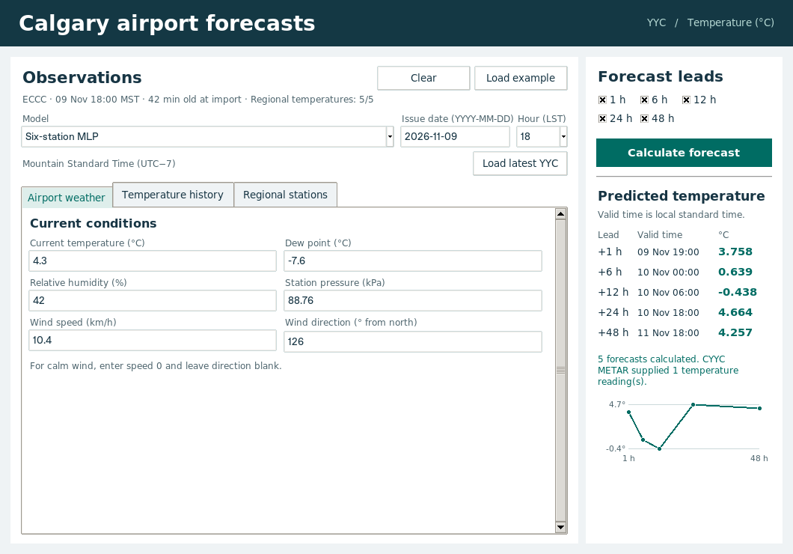

# Calgary temperature forecasting

How much can five surrounding weather stations improve a temperature forecast for Calgary International Airport (YYC)? This Python project compares hourly forecasts from 1 to 48 hours ahead using ten years of Environment and Climate Change Canada (ECCC) station observations. The code, cleaned data, fitted neural-network weights and predictions are included.

**At six hours, the six-station MLP reduced 2025 RMSE by 13.02%, from 2.676°C to 2.328°C, across 8,102 matched forecast origins.** The airport-only and six-station MLPs shared their training protocol. The value of the extra inputs diminished with lead and the point estimate reversed at 48 hours. [Read the research paper](report/Calgary_Temperature_Forecasting.pdf) · [LaTeX source](report/Calgary_Temperature_Forecasting.tex)

## Open the desktop forecast window

Open this folder in PyCharm, choose a Python interpreter with NumPy installed, and run **[forecast_gui.py](forecast_gui.py)**. The app opens a native desktop window. Predictions run locally. Importing current observations requires an internet connection. On Windows, you can also launch it from PowerShell in the folder containing this README.

~~~powershell
py -3.12 -m venv .venv
.\.venv\Scripts\python.exe -m pip install numpy
.\.venv\Scripts\python.exe .\forecast_gui.py
~~~

The first two commands are one-time setup. On later launches, run the last command. With an activated environment on any supported desktop, run **python forecast_gui.py**. The window uses Tkinter, which ships with the standard Windows Python installer. Linux users whose Python lacks Tkinter need the Tk package for their interpreter.

1. Select the model and leads, then click **Load latest YYC** for a current forecast. To enter readings yourself, start with the labelled historical example or select **Clear**.
2. Choose a model and the issue date and hour in fixed Mountain Standard Time (UTC−7). For the six-station MLP, enter airport conditions, the 24 hourly temperatures, and readings in the **Regional stations** tab. Changing station preserves your earlier entries. Blank regional fields use the training median. For a sequence model, enter the histories by station, oldest hour first. The window calculates wind and calendar encodings automatically where the model uses them.
3. Select any of **1, 6, 12, 24 and 48 h**, then click **Calculate forecast**. The results give the YYC temperature in °C and local valid time. Editing an input clears the previous results.

**Live observations.** The button requests hourly surface station reports from YYC and the five regional training stations. It populates the form and calculates the selected leads from the latest usable YYC hour within the past three hours. Check the displayed issue hour (fixed MST, UTC−7), age at import, and regional coverage. Each forecast lead begins at that observation hour. Click again to refresh. You can edit the imported readings and recalculate.

The importer matches station climate identifiers and exact UTC hours, retrieves the preceding 23 hourly lags, and converts station pressure from hPa to kPa. When an airport temperature lag is missing, it looks for the same hour in a routine CYYC METAR. Those temperatures can have coarser precision. The status line reports how many were used. Missing optional readings use the model's trained imputation and masks. When required airport readings are unavailable or stale, the import reports the problem. The published test scores use the historical climate archive. [ECCC real-time surface observations](https://api.weather.gc.ca/collections/swob-realtime) · [Aviation Weather Center METAR data](https://aviationweather.gov/data/api/)

For a quick check, choose **Six-station MLP** and **Load example**. At 6 h the forecast is **−14.028°C**. On **Regional stations**, choose **Bow Valley**, change the temperature at 0 h from **−11.5** to **−10.5°C**, and calculate again. The six-hour result becomes **−13.988°C**.



## Use the predictor from a script or command line

The bundled [predictor](predict.py) applies the fitted weights to a single forecast origin and returns the predicted temperature at Calgary International Airport in °C. In Windows PowerShell, open the extracted directory containing this README.

```powershell
py -3.12 -m venv .venv
.\.venv\Scripts\python.exe -m pip install numpy
Copy-Item .\examples\spatial.json .\my_weather.json
notepad .\my_weather.json
.\.venv\Scripts\python.exe .\predict.py --model spatial --input .\my_weather.json --lead 6
```

Edit the numbers in `my_weather.json` and save before running the last command. If your environment is already set up, start at the copy step. On macOS or Linux (or in an activated environment), run `python predict.py --input my_weather.json --lead 6`. With the original example unchanged, the six-hour temperature is **−14.028°C**. Change just `bow_valley_temp_lag_0` from `-11.5` to `-10.5` and it becomes **−13.988°C**. Omit `--lead` for all five forecasts, add e.g. `--lead 6 24` for a subset, or use `--json` for machine-readable output.

| `--model` | Manual input | Ready-to-edit example |
| --- | --- | --- |
| `spatial` (default) | 67 values: 34 airport and calendar features and 33 regional features | [spatial.json](examples/spatial.json) |
| `local` (matched) or `standalone-local` (original airport fit) | 34 airport and calendar features | [local.json](examples/local.json) |
| `sequence-mlp` or `sequence-tcn` | 24 hourly rows × 24 physical readings, plus 4 calendar values. Seed 2403 by default, also 17 or 2026 | [sequence.json](examples/sequence.json) |

Run `python predict.py --model spatial --schema` to print the ordered feature names, units, and permitted missing values. A named JSON object can be reordered. A JSON array must follow the printed order exactly. Supply temperatures and dew points in °C, station pressure in kPa, wind speed in km/h and relative humidity on a 0–100 scale. The program applies the stored training scalers and missing-value rules.

**Building a vector.** Airport temperature lags run from the current hour back to 23 hours ago in the engineered models. Regional temperature lags are 0, 3 and 6 hours. Wind direction uses sine and cosine of the meteorological direction in degrees (convert to radians). For calm wind the pair (0, 0) is supported, as in the calm-hour sensitivity analysis. Calendar entries are sine and cosine of 2π × fixed local standard hour / 24 and of 2π × day of year / 365.25. January 1 is day 1. For the regional MLP, use JSON `null` for unavailable auxiliary readings and include every field name. An absent reading is distinct from a measured zero.

The sequence input has **oldest hour first**. Each hourly row contains temperature, dew point, relative humidity and wind speed for YYC, Bow Valley, Sundre, Drumheller, Claresholm and Lacombe, in that order. The final calendar vector is for the forecast origin. Missing readings can be `null` except for the current YYC temperature. The predictor constructs the observation masks. The CLI accepts the nested sequence example, a flat 580-value array or a named object using the printed schema.

**Using an ordered vector in Python.** The example below shows the full 34-value airport vector at 00:00 LST on 1 January 2025. Modify any component, then rerun. No labels, dates, historical files, PyTorch or training step are required for prediction.

```python
from predict import predict_temperature

x = [
    -12.6, -11.5, -10.8, -10.5, -10.5, -10.3, -9.9, -9.2,  # 0–7 h ago
     -8.9,  -8.5,  -8.2,  -7.4,  -7.5,  -7.8, -8.4, -8.6,  # 8–15 h
     -8.5,  -8.3,  -8.0,  -8.0,  -7.7,  -7.7, -7.7, -7.7,  # 16–23 h
    -14.5, 85.0, 89.44, 13.0,                               # dew point, RH, pressure, wind speed
     0.6427876097, 0.7660444431,                             # wind direction sin, cos
     0.0, 1.0, 0.0172015754, 0.9998520420,                  # hour and day-of-year sin, cos
]
print(round(predict_temperature(x, model="local", horizons=6)[6], 3))  # -14.402
```

To paste a vector directly into a terminal, run `python predict.py --model local --lead 6`, paste a single-line JSON array of 34 numbers, and press Enter. A literal array can also be passed to `--features`. For a standalone deployment, keep `predict.py` beside `inference/forecast_weights.npz`. After retraining with the project scripts and updating their preprocessing outputs, run `python export_prediction_weights.py` to regenerate the portable bundle from the checkpoints.

## Test-year results

| Lead | Persistence RMSE | Airport MLP RMSE | Six-station MLP RMSE | Relative RMSE reduction | 95% paired block interval |
| ---: | ---: | ---: | ---: | ---: | ---: |
| 1 h | 1.411°C | 1.073°C | 0.986°C | 8.15% | 6.77% to 9.70% |
| 6 h | 5.286°C | 2.676°C | 2.328°C | 13.02% | 10.29% to 15.78% |
| 12 h | 7.264°C | 3.551°C | 3.244°C | 8.65% | 5.97% to 11.37% |
| 24 h | 5.770°C | 4.634°C | 4.457°C | 3.82% | 1.77% to 5.57% |
| 48 h | 7.216°C | 5.750°C | 5.782°C | −0.55% | −2.85% to 1.47% |

Each row covers the same 8,102 origin hours. Intervals resample consecutive seven-day blocks of 2025 dates with both models paired, conditional on their fitted weights. The single target site and test year limit geographic and year-to-year generalization. The project measures retrospective forecast skill using archived observations. Real-time observation latency and operational NWP forecasts were outside the evaluation.

## Verify the results in one command

From the extracted project root, run `python verify_results.py` with Python 3.12, NumPy and pandas installed. The script rebuilds local and regional inputs from the station files, checks every engineered comparison forecast and all six sequence runs against YYC observations, replays ten matched MLP weight sets, and writes the [block intervals](results/verification/paired_rmse_gains.csv) and [calm-wind sensitivity](results/verification/calm_wind_sensitivity.csv). It also compares the scores of the published architectures and seasons with their saved tables. This path runs offline on a CPU.

For a fresh environment on Windows PowerShell, run these commands from the folder containing this README.

```powershell
py -3.12 -m venv .venv
.\.venv\Scripts\python.exe -m pip install "numpy>=2.0" "pandas>=2.0"
.\.venv\Scripts\python.exe verify_results.py
```

The verification was run with Python 3.12.14, NumPy 2.3.5 and pandas 2.2.3. The tested statistical refits used scikit-learn 1.8.0 and SciPy 1.17.0. For training and download scripts, install the complete dependencies with `python -m pip install -r requirements.txt`. In PowerShell use `.\.venv\Scripts\python.exe` wherever `python` appears below.

## Design and case selection

- **Training, validation, test.** The engineered models use 2016–2023, 2024 and 2025 respectively. Each lead's target time must fall within its split. The joint sequence models apply that rule to their 48-hour target. Medians, means, scales and PCA were fitted on training data. Model selection used validation data.
- **Inputs.** The airport model uses 34 predictors, including 24 temperature lags. Bow Valley, Sundre A, Drumheller East, Claresholm and Lacombe CDA 2 supply 33 additional inputs. The [feature manifest](spatial_extension/data/processed/spatial_feature_manifest.csv) records the source, variable and lag. Station selection considered geographic coverage and record completeness.
- **Why three test counts appear.** The standalone airport experiment included 8,480 hours. The matched engineered experiment required a reported local wind direction and included 8,102. All 378 additional cases had zero wind speed with missing direction. The sequence experiment used missingness masks and had 8,664 origins before matching. Architecture comparisons use the intersection. Each retained case had all five verifying temperatures. A frozen-weight sensitivity test on all 8,480 eligible airport hours gave a 13.43% six-hour gain.

## Reproduce the expanded report

Run `python -m report.analyze_diagnostics` to regenerate the [diagnostic tables](report/results), including calendar-adjusted persistence, paired large-error frequencies, valid-time seasonal scores, Bow Valley temperature-contrast groups, and the two case-study weeks. Run `python -m unittest discover -s tests -v` to compare the manual-vector interface against archived forecasts from all 21 neural-network checkpoints. Both commands use the offline verification environment above.

## Run individual experiments

Run these commands from the project root. Commands ending in `--evaluate-test` for the neural networks load previously saved checkpoints. The two OLS scripts fit their coefficients from training data. Longer training commands write a new set of results in the extracted project.

| Task | Command |
| --- | --- |
| Standalone airport persistence and OLS | `python train.py --evaluate-test` |
| Replay standalone airport MLPs and build figures | `python train_mlp.py --evaluate-test` then `python evaluate.py` |
| Rebuild the matched data from bundled clean station records | `python spatial_extension/preprocess_spatial.py` |
| Fit and score regional OLS | `python spatial_extension/train_spatial.py --evaluate-test` |
| Replay matched airport and six-station PyTorch MLPs | `python spatial_extension/train_spatial_mlp.py --evaluate-test` |
| Export the ten matched MLPs for the verification script | `python spatial_extension/train_spatial_mlp.py --export-numpy` |
| Refresh the complete manual-prediction bundle after retraining | `python export_prediction_weights.py` |
| Repeat baseline fits | `python architecture_extension/train_pcr.py` and `python architecture_extension/train_lightgbm.py` |
| Rebuild sequence predictions from six checkpoints | `python architecture_extension/predict_sequence_models.py` |
| Recompute common-case metrics, seasonality and OLS ablations | `python architecture_extension/analyze_extended.py` |
| Refit 48 direct OLS forecasts and all three error-growth curves | `python architecture_extension/error_growth.py` |

To repeat neural training, first run `python train.py` then `python train_mlp.py` for the standalone airport search. Use `python spatial_extension/train_spatial_mlp.py` for the fixed matched MLPs and `python architecture_extension/train_sequence_models.py --models MLP,TCN --seeds 2403,2026,17` for the joint sequence experiment. Run the corresponding prediction and evaluation commands afterward. The report source embeds its plot coordinates and compiles as a single file with XeLaTeX.

## Data and supporting material

Based on Environment and Climate Change Canada data. The download scripts record the station IDs and the cleaned hourly snapshot supplied here covers January 2016 through December 2025. The raw monthly downloads are optional and the live archive can receive revisions. [ECCC Historical Climate Data](https://climate.weather.gc.ca/) · [ECCC data licence](https://climate.weather.gc.ca/prods_servs/attachment1_e.html) · [Station inventory used](spatial_extension/data/station_download_summary.csv)

[Project findings and résumé wording](PROJECT_SUMMARY.md) · [File guide](MANIFEST.md) · [Verification notes](results/sanity_checks/SANITY_CHECKS.md) · [Optional external forecast scorer](eccc_benchmark/README.md)
